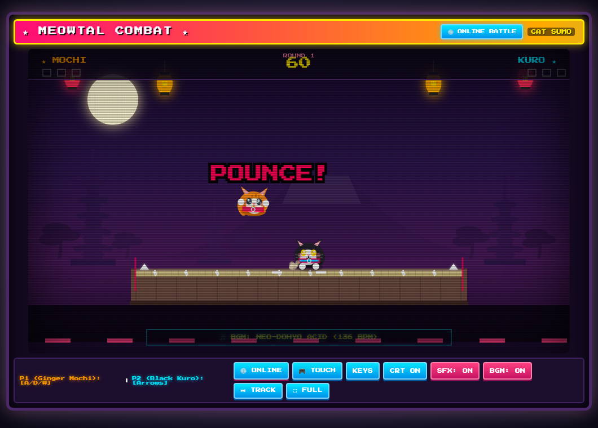
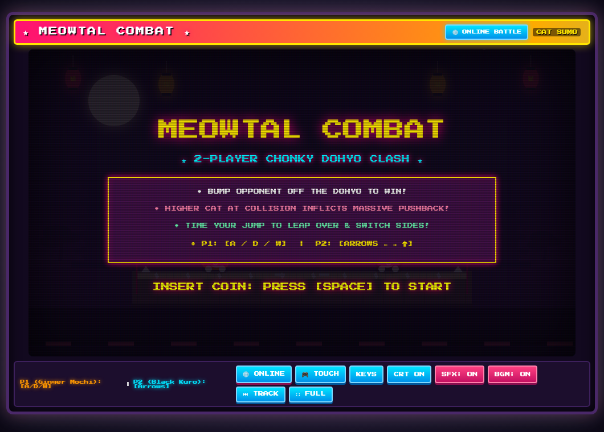
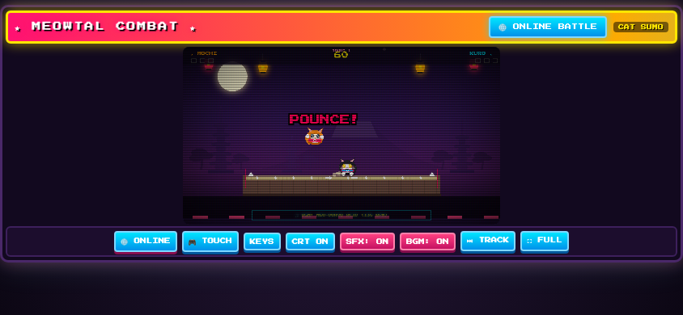
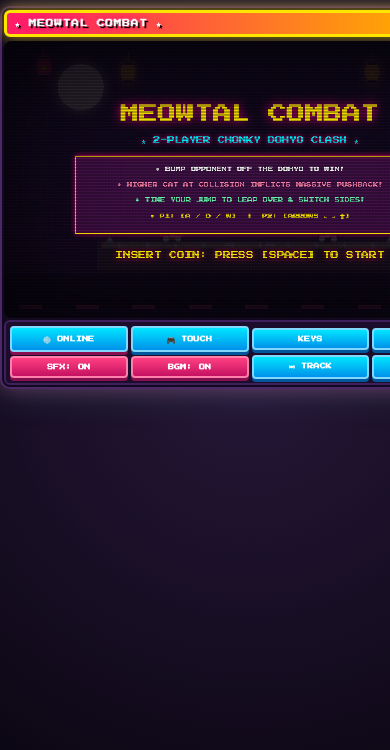

# 🐾 MEOWTAL COMBAT 🥋

[](https://github.com/Tombio/meowtal-combat/actions/workflows/deploy.yml)
[](https://tombio.github.io/meowtal-combat/)
[](https://developer.mozilla.org/en-US/docs/Web/Progressive_web_apps)
[](https://www.typescriptlang.org/)
[](https://vitejs.dev/)
[](https://webrtc.org/)
[](https://developer.mozilla.org/en-US/docs/Web/API/Web_Audio_API)

> **A 90s arcade 2-player sumo platform fighter featuring chonky cats battling atop a sacred Dohyo.**  
> Bump your opponent off the ring, time aerial pounces for mega knockbacks, and duel friends locally or online via peer-to-peer WebRTC!

👉 **[PLAY NOW IN BROWSER](https://tombio.github.io/meowtal-combat/)**

---

## 📸 Screenshots

| Desktop Gameplay | Arcade Cabinet & Title |
| :---: | :---: |
|  |  |

| Mobile Landscape & Touch Controls | Mobile Portrait Layout |
| :---: | :---: |
|  |  |

---

## ⚡ Features

### 🐾 4 Fighter Archetypes & Character Selection Screen
- **Authentic 90s Character Select Grid**: Choose your fighter before every duel with live animated pixel-art previews, breed lore, and stat radar bars (**SPEED ⚡**, **WEIGHT ⚖️**, **JUMP 🐾**).
- **Asymmetrical Weight & Mobility Archetypes**:
  - **Mochi (The Balanced Sumo)**: Ginger Tabby. Standard mass (1.00x), balanced jump, and reliable sumo knockback fundamentals.
  - **Kuro (The Shadow Shinobi)**: Black Tuxedo. Fast ground mobility (1.16x waddle speed) and rapid ring repositioning.
  - **Boris (Yokozuna Chonk)**: British Blue. Immense mass (1.25x) provides ~20% knockback resistance against incoming pounces; heavier ground presence with 0.84x waddle speed.
  - **Wasabi (The Flying Acrobat)**: Calico Bobtail. Soaring leap altitude (1.16x jump multiplier, ~208px peak) for steep, punishing aerial pounces.
- **Strict Competitive Safeguards**: All fighters adhere to a zero-sum attribute budget ($\pm 15\text{--}20\%$ corridor) and clear the 52px vaulting jump threshold ($>120\text{px}$ clearance).

### 🏆 Post-Match Battle Stats & Cinematic KO Cam
- **Cinematic KO Cam**: Final match-winning ring-outs trigger 0.35x slow-motion pacing, screen shutter flash, and a comic `★ K.O. ★` freeze-frame banner.
- **Head-to-Head Match Stats Screen**: Comprehensive recap tracking **Bumps Landed**, **Mega Bonks**, **Defensive Parries**, **Turbo Punches**, and **Edge Teeter Clutches**.
- **Dynamic MVP Titles**: Awards fighters custom accolades like *The Parry Sensei*, *Meteor Stomper*, *The Edge Lord*, *Dragon Combo Master*, or *Tournament Yokozuna*.

### 📱 Progressive Web App (PWA) & Mobile Fullscreen
- **Installable PWA**: Installable directly on Android, Chrome, and iOS (Safari "Add to Home Screen") as a standalone app.
- **Offline Capable**: Pre-caches game assets via a custom Service Worker (`sw.js`) with cache-first and stale-while-revalidate strategies.
- **Fullscreen Cabinet Mode**: Fullscreen toggle (`⛶ FULL`) expands the entire arcade experience edge-to-edge (with iOS Safari emulated fallback and landscape orientation lock) while keeping on-screen touch buttons and all toolbar controls (**ONLINE**, **TOUCH**, **KEYS**, **CRT**, **SFX**, **BGM**, **TRACK**) visible and accessible.
- **Responsive Touch Layout**: Adaptive 4x2 control button grid for portrait orientation and non-occluding corner touch D-pad in landscape.

### 🥋 Chonky Sumo Physics & Combat
- **Height-Advantage Pounce Mechanic**: Collisions scale dynamically with altitude difference. Higher cats dropping onto opponents trigger screen shake, comic popups (`CLASH!`, `BONK!`, `POUNCE!`), hit-stop freeze frames, and massive horizontal knockback!
- **Jump-Over Clearance**: Leap altitude is tuned to allow vaulting cleanly over an opponent to switch sides and evade ring-outs.
- **Dohyo Ring-Out Detection**: Push your opponent off the platform into the pit to take the round. Best 3 out of 5 rounds wins the tournament.

### 🛡️ Defensive Parry (Just-Guard) & Anti-Camping
- **12-Frame Just-Guard Window**: Press <kbd>S</kbd> (P1), <kbd>↓</kbd> (P2), or the mobile `🛡️ PARRY` button right before impact to deflect incoming attacks!
- **Zero Knockback & Attacker Stun**: Absorbs all incoming kinetic momentum and inflicts **24 frames of DAZED stun** on the attacker (or **36 frames against a charging Turbo Attack**, halting their dash with massive recoil).
- **Anti-Camping Whiff Penalty**: Cannot be held down! Holding or mistiming the parry triggers an **18-frame helpless whiff recovery** (`PARRY_WHIFF` state) with movement locked and full vulnerability, plus a 40-frame cooldown.

### ⚡ Turbo Attack & Giga Bonk
- **Dragon Punch Command Combo**: Tap **Back → Back → Forward** relative to your opponent's position within a 666ms window (20 frames per step) to launch a high-speed charge across ~160px (27.5% of the Dohyo).
- **Airborne Charge**: Works both grounded and in mid-air with aerodynamic horizontal levitation!
- **Jump Evasion Counterplay**: The punch is swift, but tuned so an attentive opponent who jumps can cleanly vault over the charging cat to evade ring-out.
- **💥 GIGA BONK! 💥**: Direct impact delivers 9.8 px/frame knockback, 28 daze frames, magnitude 16 screen shake, and a 5-frame freeze-frame impact crunch!
- **Exhaustion Cooldown & Overhead Gauge**: Initiates a 4-second cooldown with a retro neon progress gauge floating over the cat's head. Locomotion speed is halved (50%) during recovery until the bar refills and a chime rings.
- **⚡ SUPER CLASH! ⚡**: Two cats dashing into each other collide in an explosive super clash blasting both fighters backward.

### 🤖 CPU Opponent AI & Single-Player Mode
- **1P VS CPU (Default)**: Play solo against an intelligent AI cat opponent without needing a second player.
- **3 Dynamic AI Difficulties**:
  - **Easy (Chonky Kitten)**: Playful, slow stalking, occasional jumps, ideal for warm-up.
  - **Normal (Sensei Neko)**: Spacing control, ring-edge avoidance, tactical counter-jumps.
  - **Hard (Grandmaster Shihan)**: Reads incoming Turbo Attacks with reactive jump dodges, punishes whiffed/dazed opponents with instant Turbo charges, and executes defensive parries.

### ⛩️ Themed Arenas & Stage Shuffling
- **Mount Fuji Dojo**: Traditional wood and tatami dohyo framed by cherry blossoms and iconic snow-capped peaks.
- **Neo-Tokyo Cyberpunk Rooftop**: Neon-drenched synthwave skyline with pulsing holographic signs and cyan grid platform.
- **Midnight Thunder Shrine**: Storm-weathered slate stone shrine with dynamic rain particles and lightning flash flashes on heavy parries and bonks.
- **🎲 Random Stage & BGM Shuffling**: Both arenas and 90s chiptune tracks dynamically shuffle between matches and rounds without repeating the same arena or song consecutively.

### ☰ Retro Arcade Main Menu & Clean Toolbar
- **De-cluttered 4-Button Toolbar**: Replaced cramped buttons with a streamlined bar: `☰ MENU`, `🌐 ONLINE`, `🎮 TOUCH`, and `⛶ FULL`.
- **Integrated Arcade Overlay**: Access mode selection (1P CPU / 2P Local / Online Duel), difficulty toggles, stage select, CRT/SFX/BGM toggles, key rebinding, and moves reference in one retro cabinet overlay.

### 🌐 Peer-to-Peer Online Multiplayer
- **Zero Server Setup**: Powered by direct WebRTC DataChannels using PeerJS with public STUN fallbacks.
- **Instant Room Codes & Share Links**: One-click room creation with 6-character room codes (`cat-xxxx`) and direct WhatsApp duel invite buttons.
- **Hybrid Client-Side Prediction Netcode**:
  - **0ms Local Prediction for Guest**: Kuro responds immediately with local client prediction for walking and jumping.
  - **Host Authority**: Authoritative combat knockbacks, ring-outs, and dohyo boundary checks originate on the host.
  - **Dynamic Reaction Equalizer**: Adaptive host input delay buffer based on live ping levels the reaction field.
  - **Real-Time Lag Meter**: Arcade HUD chip displays live ping with color-coded RTT status (🟢 `< 60ms`, 🟡 `60–130ms`, 🔴 `> 130ms`).

### ⏱️ Ready Check & "3, 2, 1, MEOW!" Countdown
- **Strictly Mapped-Button Acknowledgment**: Prior to every round, both players must acknowledge by pressing any of their mapped controls (<kbd>A</kbd>/<kbd>D</kbd>/<kbd>W</kbd>, Arrows, or touch buttons).
- **Retro Arcade Countdown**: Once both players are ready, the dohyo erupts into a pulsing countdown (`3` → `2` → `1` → **`MEOW!`**) with authentic Taiko drum strikes.

### 🎵 16-Bit Procedural Web Audio
- **Zero MP3s or Audio Assets**: 100% synthesized in real time via the native Web Audio API.
- **Dynamic Chiptune Tracks**: Multi-track procedural BGM that switches automatically across tournament rounds (Neo-Dohyo Acid, Shinobi Dub, Tokyo Metropolis, Final Climax Rave).
- **Retro Sound Effects**: Taiko Don bass drums, rim shots, cute meows, impact bonks scaled to fall height, and celebratory victory fanfares.

### 🕹️ Arcade Polish & Accessibility
- **CRT Shader & Arcade Cabinet**: Scanlines, bezel curvature, floating cherry blossom petals, and glowing rainbow marquee.
- **Mobile Touch Controls**: Responsive touch D-pad and jump button with automatic mobile device detection.
- **Custom Key Rebinding**: Rebind any control for P1 and P2 with persistent local storage saving.

---

## 🎮 Controls

| Action | Player 1 (Mochi - Ginger Tabby) | Player 2 (Kuro - Black Cat / CPU) | Mobile Touch |
| :--- | :--- | :--- | :--- |
| **Move Left** | <kbd>A</kbd> | <kbd>←</kbd> | ◀ Button |
| **Move Right** | <kbd>D</kbd> | <kbd>→</kbd> | ▶ Button |
| **Jump / Pounce** | <kbd>W</kbd> | <kbd>↑</kbd> | 🐾 JUMP Button |
| **🛡️ Defensive Parry** | <kbd>S</kbd> | <kbd>↓</kbd> | 🛡️ PARRY Button |
| **⚡ Turbo Attack** | Back-Back-Forward (<kbd>A</kbd><kbd>A</kbd><kbd>D</kbd> or <kbd>D</kbd><kbd>D</kbd><kbd>A</kbd>) | Back-Back-Forward (<kbd>←</kbd><kbd>←</kbd><kbd>→</kbd> or <kbd>→</kbd><kbd>→</kbd><kbd>←</kbd>) | Quick ◀ ◀ ▶ or ▶ ▶ ◀ |
| **Ready Up (Round Start)** | Any P1 Control (<kbd>A</kbd>, <kbd>D</kbd>, <kbd>W</kbd>, <kbd>S</kbd>) | Any P2 Control (<kbd>←</kbd>, <kbd>→</kbd>, <kbd>↑</kbd>, <kbd>↓</kbd> / Auto on CPU) | Touch JUMP / PARRY / Movement |
| **Start / Rematch** | <kbd>Space</kbd> or <kbd>W</kbd> | <kbd>Space</kbd> or <kbd>↑</kbd> | Touch JUMP |

*Controls can be rebound at any time via the **☰ MENU → ⌨ REBIND KEYS** modal.*

---

## 🛠️ Development & Setup

### Prerequisites
- Node.js 18+
- npm 9+

### Installation
```bash
# Clone the repository
git clone git@github.com:Tombio/meowtal-combat.git
cd meowtal-combat

# Install dependencies
npm install
```

### Running Locally
```bash
# Start Vite development server
npm run dev
```
Open [http://localhost:5173](http://localhost:5173) in your browser.

### Running Test Suite
```bash
# Run headless physics, collision, and netcode simulation tests
npm test
```

### Production Build
```bash
# Typecheck and build static production assets
npm run build

# Preview production build locally
npm run preview
```

---

## 🚀 Deployment

The game automatically builds and deploys to **GitHub Pages** via the included [GitHub Actions workflow](.github/workflows/deploy.yml) on every push to `main`.

Live site: **`https://tombio.github.io/meowtal-combat/`**

---

## 📜 Architecture Overview

```
meowtal-combat/
├── src/
│   ├── audio/
│   │   ├── BGMTrack.ts         # Procedural multi-track 90s chiptune synthesizer
│   │   └── SoundSynthesizer.ts # Web Audio API sound effects & Taiko drums
│   ├── engine/
│   │   ├── Collision.ts        # Height-scaled bump & shove collision resolution
│   │   ├── Effects.ts          # Comic popups, dust particles, screen shake, hit stop
│   │   └── InputManager.ts     # Input handling, role isolation, key rebinding
│   ├── entities/
│   │   ├── Arena.ts            # Dohyo boundaries, platform coordinates, ring-out
│   │   └── Cat.ts              # Cat state machine, physics, animation frames
│   ├── network/
│   │   └── NetworkManager.ts   # WebRTC PeerJS signaling, P2P sync, ping loop
│   ├── render/
│   │   ├── ArenaRenderer.ts    # Dojo background, lanterns, Mount Fuji, moon
│   │   └── CatRenderer.ts      # Pixel art rendering for Mochi and Kuro
│   ├── ui/
│   │   ├── ArcadeHUD.ts        # Top ribbon, 3-2-1 MEOW countdown, ready banners
│   │   ├── KeyModal.ts         # Retro key rebind modal UI
│   │   ├── OnlineModal.ts      # Room hosting, joining, WhatsApp share
│   │   └── TouchController.ts  # On-screen mobile touch controls
│   └── main.ts                 # Main game loop, netcode reconciliation, lifecycle
├── test/
│   └── gameplay-simulation.test.ts # 13 headless end-to-end simulation suites
└── screenshots/                # Game screenshots for documentation
```

---

## 📄 License

MIT © [Tomi Lahtinen](https://github.com/Tombio)
